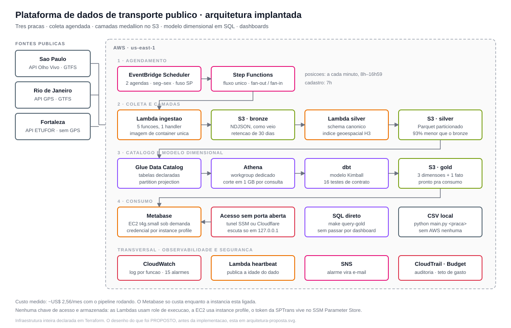

# Plataforma de dados de transporte público

Pipeline de dados que coleta, normaliza e disponibiliza para análise os dados
abertos de ônibus de **São Paulo, Rio de Janeiro e Fortaleza**.

## O problema

As três cidades publicam dados de ônibus, e as três publicam de um jeito
diferente: formatos distintos (JSON de API, GTFS em zip), cadências distintas,
campos com nomes distintos para a mesma coisa, e nenhum compromisso de aviso
quando algo muda. Quem quiser responder uma pergunta simples — *quantos
veículos estão circulando agora em cada cidade?* — precisa primeiro resolver
três integrações, três formatos e três conjuntos de armadilhas.

Pior: os dados de posição são **efêmeros**. A API diz onde os veículos estão
agora e nada mais; não há histórico. Quem não coletar, perde.

## A ideia

Capturar o dado efêmero antes que ele desapareça, guardá-lo exatamente como
veio, e construir por cima dele camadas que vão ficando mais fáceis de
consultar — sem nunca perder o original.

É a **arquitetura medallion**, e ela resolve o conflito entre duas coisas que
se quer ao mesmo tempo: fidelidade à origem e conveniência para quem consulta.

| Camada | O que guarda | Por quê |
|---|---|---|
| **bronze** | NDJSON, exatamente como a fonte entregou | se a origem mudar um campo, o histórico continua íntegro e reprocessável |
| **silver** | Parquet, schema canônico, índice geoespacial H3 | as três cidades viram **uma** tabela, com os mesmos nomes de campo |
| **gold** | modelo dimensional (dimensões + fato) | quem consulta não precisa saber que o cadastro é refotografado a cada coleta |

Três princípios guiaram as decisões:

- **Degradar, não quebrar.** Uma fonte fora do ar não pode derrubar as outras.
  Isso foi testado na prática: o GTFS do Rio ficou semanas fora do ar e as
  demais praças seguiram carregando normalmente.
- **Custo proporcional ao uso.** Nada ligado 24/7 que possa ser sob demanda.
  O projeto inteiro custa ~US$ 2,56/mês.
- **Nenhuma chave de acesso armazenada.** As Lambdas usam role de execução, a
  EC2 usa instance profile, o token da SPTrans vive no SSM Parameter Store.

## Arquitetura



O que cada etapa faz:

1. **Agendamento.** O EventBridge dispara o Step Functions duas vezes: posições
   a cada minuto (8h–16h59, seg–sex) e cadastro às 7h. Um fluxo genérico
   recebe a lista de fontes a coletar — ele não sabe nada sobre praça nem
   cadência, então acrescentar uma cidade não altera o fluxo.
2. **Coleta.** Cinco funções Lambda gravam no bronze. As cinco rodam a **mesma
   imagem de container**; o que muda entre elas é a variável `FONTE`.
3. **Normalização.** Terminada a coleta, o fluxo chama a Lambda silver, que
   converte para Parquet no schema canônico e calcula o índice geoespacial H3.
4. **Catálogo e modelo.** O Glue descreve as tabelas (declaradas, sem crawler)
   e o Athena consulta. O dbt constrói por cima a camada gold, com testes que
   falham quando uma premissa do modelo quebra.
5. **Consumo.** Metabase para dashboards, Athena para SQL direto, ou CSV local
   sem AWS nenhuma.

A infraestrutura inteira é declarada em Terraform — não há recurso criado na
mão pelo console.

## Começando — sem conta AWS, sem token

Três comandos, do zero até uma coleta de verdade:

```bash
make setup    # cria o venv, instala dependências e o .env
make check    # diz o que já funciona e o que falta configurar
make demo     # coleta o Rio inteiro de verdade (~7s) -> output/rio/
```

O `make demo` usa o Rio de propósito: é a única praça que entrega linhas,
posições e pontos **sem credencial nenhuma**. Dá para ver o projeto
funcionando antes de configurar qualquer coisa.

`make` sozinho lista todos os comandos. E `make check` olha a **sua** máquina:
diz o que já roda agora e, para o que não roda, o motivo e o comando que
resolve — em vez de você descobrir pelo traceback.

### Rodando as outras praças

```bash
make run-rio          # Rio — sem token
make run-fortaleza    # Fortaleza (~2 min) — sem token
make run-sptrans      # São Paulo — exige SPTRANS_TOKEN no .env
make run-all          # as três em sequência
```

O token da SPTrans sai de um [cadastro
gratuito](https://www.sptrans.com.br/desenvolvedores/) e vai no `.env`.

## Subindo tudo na AWS

Pré-requisitos: credencial AWS configurada (`aws configure`), Docker rodando e
Terraform instalado.

```bash
make bootstrap    # do zero até rodando: ECR -> imagem -> infra -> modelos dbt
```

Um comando só, porque a ordem importa: a imagem precisa existir no ECR
**antes** do apply, já que a Lambda não aceita ser criada apontando para uma
tag que ainda não existe. O `bootstrap` faz a sequência inteira na ordem certa.

Depois dele a infraestrutura existe, mas **os agendamentos nascem desligados**
— de propósito, para ninguém gerar custo sem querer:

```bash
make tf-ligar      # passa a coletar sozinho (e a gerar custo)
make status        # os pipelines estão entregando?
make tf-desligar   # para a coleta; nada é destruído
```

### Consultando

```bash
make query SQL="SELECT praca, count(*) FROM posicoes GROUP BY praca"
make query-gold SQL="SELECT * FROM dim_linhas LIMIT 5"
make dbt-build     # reconstrói a camada dimensional e roda os testes
```

### Dashboards

```bash
make metabase              # Metabase local, na sua máquina (sem custo AWS)

make metabase-aws-ligar    # ou na AWS: liga a instância
make metabase-aws-tunel    # abre o túnel -> http://localhost:3000
make metabase-aws-desligar # desliga; os dashboards ficam no disco
```

O Metabase da AWS **não tem endereço público**. Ele escuta em `127.0.0.1` e
nenhuma porta é aberta; o acesso passa por um túnel SSM (cifrado, autorizado
por IAM, registrado no CloudTrail) ou por um Cloudflare Tunnel. Detalhes em
[`docs/CONSULTAS.md`](docs/CONSULTAS.md).

### Desmontando

```bash
make tf-destroy    # APAGA tudo, inclusive os dados no S3 (pede confirmação)
```

O ciclo destroy → bootstrap foi validado duas vezes: 73 recursos destruídos,
78 reconstruídos, zero divergência.

## O que procurar na conta AWS

Para conferir pelo console que está tudo de pé — e entender o que cada recurso
é — veja [`docs/AWS.md`](docs/AWS.md). É um roteiro de verificação direto,
serviço por serviço.

## Mapa do repositório

```
main.py                 CLI dos pipelines locais (sptrans | rio | fortaleza)
Makefile                todos os comandos; `make` sozinho lista

coleta/                 como falar com cada fonte: clientes HTTP, GTFS, pipelines.
                        Reusado pelas Lambdas — a lógica existe uma vez só
schemas/                contratos: models do bronze, o canônico da silver e
                        mapeamento_silver.py, o metadado que liga os dois

lambdas/
  ingestao/             UM handler para as 5 fontes + fontes.py, a tabela que as descreve
  silver/               normalização genérica, sem `if praca ==`
  heartbeat/            publica a idade do dado como métrica
  common/               validação, retry, log estruturado, escrita S3, leitura SSM

infra/
  terraform/            toda a infraestrutura; ver o README de lá
  docker/               Dockerfile único das 7 funções

transform/              modelos dbt: dimensional + geoespacial
scripts/                check_ambiente.py, status_pipeline.py, consultar.py e afins
exemplos/realtime/      producer/consumer com Redis — estudo, fora de produção
docs/                   documentação; ver a tabela no fim deste arquivo
output/                 CSVs gerados localmente (gitignored)
```

## Estado atual

| Item | Estado |
|---|---|
| Coleta local das 3 praças | funciona |
| Ingestão na AWS (bronze) | funciona |
| Normalização bronze → silver (Parquet + H3) | funciona, chamada pelo Step Functions |
| Camada gold dimensional (dbt) | funciona: 4 modelos, 16 testes |
| Catálogo Glue + Athena | funciona, com partition projection |
| Metabase na AWS, sem chave de acesso | funciona |
| Observabilidade (15 alarmes, painel, heartbeat) | funciona |
| Segurança de conta (CloudTrail, Budget, bloqueios) | funciona |
| Testes automatizados de código | **não existem** |
| CI | **não existe** |
| State do Terraform remoto | **não existe** (é local) |

### O que este repositório ainda não é

Sendo explícito, para ninguém se surpreender ao abrir:

- **O state do Terraform é local.** Sem backend remoto nem lock. Se outra
  pessoa for aplicar infraestrutura, combine antes — dois `apply` simultâneos
  corrompem o state.
- **Sem testes e sem CI.** Nada valida uma mudança antes do merge. Quatro
  regras deste projeto já quebraram na prática e seriam testes óbvios.
- **Dependências não fixadas** (`>=`) e imagem base em tag mutável: um build
  de hoje não é necessariamente igual ao de amanhã.
- **Deploy sem versão:** as funções apontam para a tag `latest` num ECR
  mutável. O `make refresh` força a adoção da imagem atual.

Nada disso impede rodar ou testar. Impede tratar como produção de empresa.

### Uma fonte que já quebrou, e como se consertou

O GTFS do Rio ficou **semanas fora do ar**: o item no ArcGIS passou a
responder `403` tanto no dado quanto nos **metadados** — que é como o ArcGIS
responde para item removido ou privado, não para bloqueio de download. A
prefeitura havia republicado em `https://dados.mobilidade.rio/gtfs/schedule`,
o mesmo host da API de GPS que o projeto já usava.

Vale registrar porque é o modo de falha típico de fonte pública aberta: **ela
não avisa que mudou**. O que o projeto fez certo foi degradar em vez de
quebrar — durante todo o período, SP e Fortaleza seguiram carregando, e o
alarme `rio-cadastro-dado-velho` ficou aceso apontando para o problema.

## Documentação

| Arquivo | O que tem |
|---|---|
| [`docs/AWS.md`](docs/AWS.md) | Roteiro de verificação na conta AWS: o que procurar, onde, e o que significa |
| [`docs/FONTES.md`](docs/FONTES.md) | Referência por fonte: formato, frequência real, particularidades e armadilhas |
| [`docs/MODELAGEM.md`](docs/MODELAGEM.md) | Entidades, chaves, grão e relacionamentos, medidos nos dados reais |
| [`docs/CONSULTAS.md`](docs/CONSULTAS.md) | Como consultar em SQL, as armadilhas de junção, e o acesso ao Metabase |
| [`docs/DECISOES.md`](docs/DECISOES.md) | Data lake vs warehouse, FinOps e plano de contingência de orçamento |
| [`docs/TEMPO-REAL.md`](docs/TEMPO-REAL.md) | O exercício de producer/consumer e os conceitos por trás dele |
| [`docs/PROPOSTA.md`](docs/PROPOSTA.md) | A proposta que originou o projeto: problema, arquitetura, custo e riscos |
| [`infra/terraform/README.md`](infra/terraform/README.md) | Deploy, operação, observabilidade e custo da infraestrutura |

### Sem `make` na máquina

O Makefile é conveniência, não dependência:

```bash
python -m venv .venv
.venv\Scripts\activate             # Windows;  source .venv/bin/activate no Linux/Mac
pip install -r requirements.txt -r lambdas/requirements.txt
copy .env.example .env             # cp no Linux/Mac
python scripts/check_ambiente.py   # = make check
python main.py rio                 # = make demo
```
