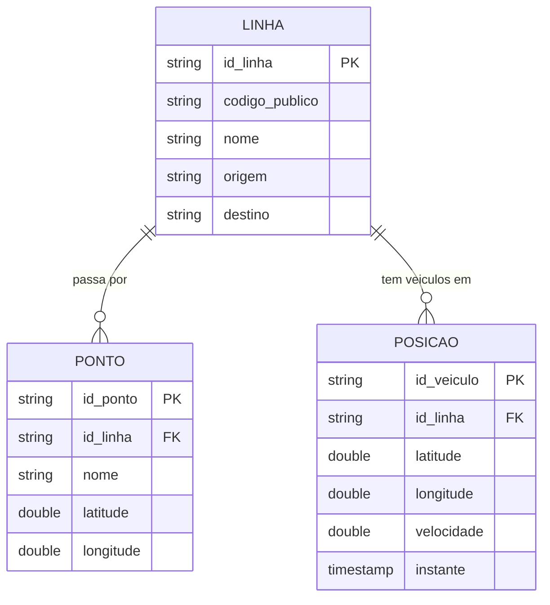
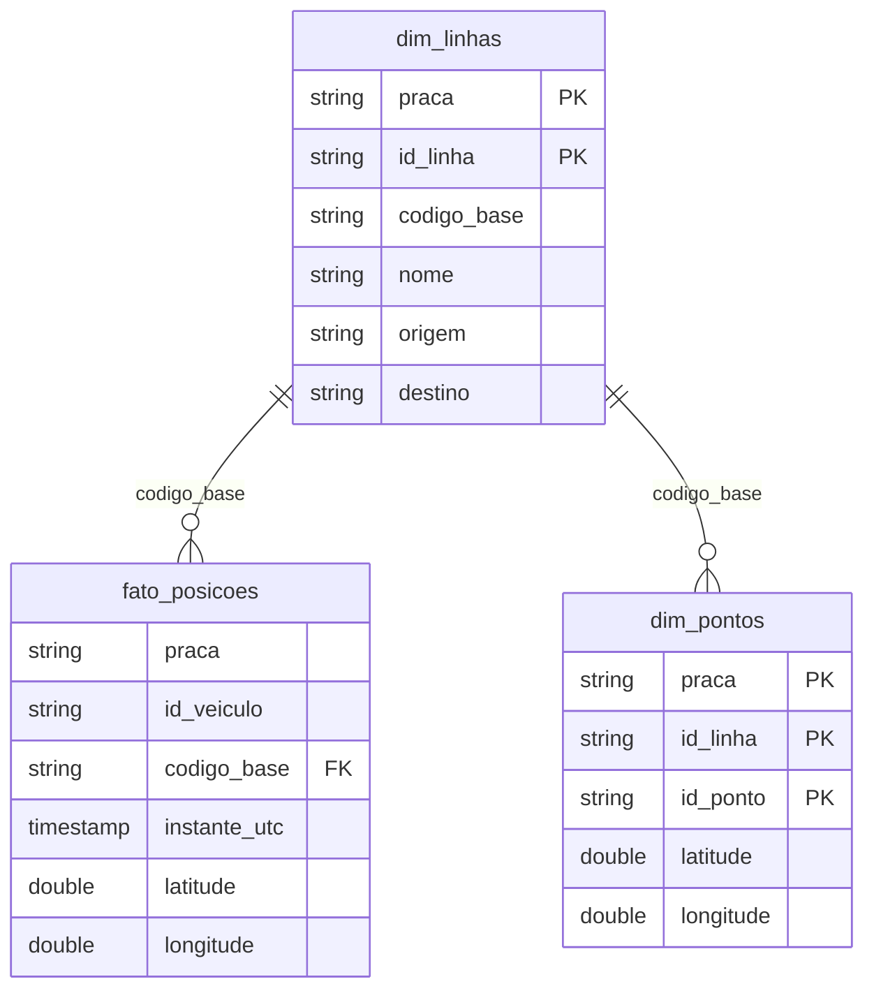

# Modelagem dos dados

Levantada a partir dos CSVs em `output/` — todo número aqui foi medido, não
estimado. Coletas de 08/09/2026 (SPTrans e Fortaleza) e 09/10/2026 (Rio).

Três entidades atravessam as três praças:

- **Linha** — o serviço de ônibus (a "2290-10 Term. São Mateus → Pq. D. Pedro II")
- **Ponto** — uma parada por onde uma linha passa
- **Posição** — onde um veículo estava num instante

As fontes modelam isso de formas incompatíveis. Este documento descreve
primeiro **como cada origem entrega**, depois **o modelo canônico** que as
unifica, e por fim **o modelo dimensional** da camada de consumo.

---

## Visão geral



O grão de cada uma, medido:

| Entidade | Uma linha representa | Chave |
|---|---|---|
| Linha | um serviço (sentido incluído) | identificador da origem |
| Ponto | **um par (linha, parada)** — não uma parada | (linha, parada) |
| Posição | um veículo num instante | veículo |

A distinção do Ponto importa: a mesma parada atende várias linhas, e cada
combinação é uma linha da tabela. No Rio, 7.520 paradas distintas geram 52.505
registros — a mesma parada aparece, em média, em 7 linhas.

---

## SPTrans (Olho Vivo + GTFS)

### `linhas` — 2.692 registros

| Coluna | Preenchido | Distintos | O que é |
|---|---:|---:|---|
| `cl` | 100% | 2.692 | **PK técnica** — código interno da linha |
| `lt` | 100% | 1.102 | letreiro base ("1012") |
| `tl` | 100% | 16 | sufixo do letreiro ("10", "21") |
| `sl` | 100% | 2 | sentido (1 = ida, 2 = volta) |
| `ts` | 100% | 564 | terminal de origem |
| `tp` | 100% | 352 | terminal de destino |
| `lc` | 100% | 2 | se é linha circular |

**Chave natural: `(lt, tl, sl)`** — medido, 2.692 combinações distintas para
2.692 registros, idêntico ao `cl`.

### `posicoes` — 10.384 registros

Grão: **um veículo**. Medido, `prefixo_veiculo` não repete (10.384 distintos
em 10.384 registros). É um retrato do momento, não um log.

| Coluna | Preenchido | Distintos | O que é |
|---|---:|---:|---|
| `prefixo_veiculo` | 100% | 10.384 | **PK** |
| `letreiro` | 100% | 1.075 | "7016-10" — letreiro **com** sufixo |
| `sentido` | 100% | 2 | 1 ou 2 |
| `horario_veiculo` | 100% | 109 | quando o veículo reportou (UTC real) |
| `latitude` / `longitude` | 100% | 8.501 | |
| `origem` / `destino` | 100% | 272 / 524 | repetidos da linha |

### `pontos` — 96.326 registros (do GTFS)

Grão: **(linha, parada)**. Medido, `(route_short_name, stop_id)` é único —
96.326 para 96.326.

| Coluna | Preenchido | Distintos |
|---|---:|---:|
| `route_short_name` | 100% | 1.325 |
| `stop_id` | 100% | 22.232 |
| `stop_name` | 100% | 20.368 |
| `stop_lat` / `stop_lon` | 100% | ~21.400 |
| `stop_desc` | 96,4% | 17.700 |

### A chave de junção da SPTrans

Esta é a descoberta mais importante do levantamento.

`posicoes.letreiro` é **"7016-10"**, mas `linhas.lt` é **"7016"**. Juntar
pelos dois diretamente devolve **zero linhas**.

Medido, comparando os conjuntos:

| Chave candidata | Cobre os letreiros de `posicoes` |
|---|---|
| `lt` sozinho | **0 de 1.075** |
| `lt \|\| '-' \|\| tl` | **1.074 de 1.075** (99,9%) |

E incluindo o sentido, a junção fica **1:1**:

```sql
posicoes.letreiro = linhas.lt || '-' || linhas.tl
AND posicoes.sentido = linhas.sl
```

Medido: 2.692 combinações `(lt-tl, sl)` para 2.692 linhas, **máximo de 1
repetição** — e 2.085 das 2.086 chaves de `posicoes` encontram par.

> **Consequência prática:** a camada gold hoje usa
> `split_part(codigo_publico, '-', 1)`, que junta `"7016-10"` com `"7016"`.
> Funciona, mas multiplica cada posição por ~2,4, porque ignora `tl` e `sl`.
> Com a chave completa o join seria exato. Ver "Dívidas do modelo".

---

## Rio de Janeiro (Data.Rio GPS + GTFS da SMTR)

### `linhas` — 498 registros (GTFS)

| Coluna | Preenchido | Distintos | O que é |
|---|---:|---:|---|
| `route_id` | 100% | 498 | **PK** — "O0636AAA0A" |
| `route_short_name` | 100% | 498 | o número do serviço ("636") |
| `route_long_name` | 100% | 352 | "Merck - Saens Peña" |
| `route_type` | 100% | 3 | tipo GTFS (700 = ônibus) |
| `route_desc` | 23,1% | 85 | |

### `posicoes` — 3.475 registros

Grão: **um veículo**, sem repetição — mas só porque
`buscar_posicao_geral()` deduplica. **A API devolve o log bruto de pings da
janela**, não um retrato. Sem a deduplicação a frota aparece ~11× inflada.

| Coluna | Preenchido | Distintos | O que é |
|---|---:|---:|---|
| `id_veiculo` | 100% | 3.475 | **PK** |
| `route_id` | 96,7% | 344 | **FK para `linhas`** |
| `servico` | 100% | 357 | o número da linha |
| `velocidade` | 100% | 73 | **só o Rio tem** |
| `datetime` | 100% | 248 | ⚠️ ver aviso abaixo |
| `latitude` / `longitude` | 100% | ~3.390 | |

### `pontos` — 52.505 registros (GTFS)

Grão: **(linha, parada)**, único — 52.505 para 52.505.

Colunas GTFS com baixo preenchimento, úteis saber antes de contar com elas:
`stop_code` 8,1%, `parent_station` 2,8%, `stop_desc` 2,4%, e
`zone_id`/`stop_url`/`stop_timezone`/`wheelchair_boarding` **vazias**.

### A junção do Rio é limpa

Diferente de SP, o Rio tem **chave estrangeira de verdade**:

| Relação | Cobertura medida |
|---|---|
| `posicoes.route_id` → `linhas.route_id` | 3.354 de 3.360 (99,8%); 115 nulos |
| `pontos.route_id` → `linhas.route_id` | 52.505 de 52.505 (100%) |
| alternativa `servico` → `route_short_name` | 343 de 357 (96,1%) |

**Use `route_id`, não `servico`.** O `servico` perde 4% dos casos.

### ⚠️ `datetime` vem em horário de Brasília com sufixo `Z`

A API devolve `2026-10-09T18:26:08Z` quando o relógio UTC marca 21:26. **É
defeito da origem**, não do pipeline. Comparar instantes entre praças sem
corrigir dá 3 horas de erro. A camada gold corrige em `instante_utc`.

---

## Fortaleza (ETUFOR)

Sem posições: a ETUFOR não expõe GPS em tempo real.

### `linhas` — 542 registros

| Coluna | Preenchido | Distintos | O que é |
|---|---:|---:|---|
| `numero` | 100% | 542 | **PK** ("617") |
| `nome` | 100% | 541 | "Abreulândia/Lagoa Redonda/Direito" |
| `numeroNome` | 100% | 542 | os dois concatenados |
| `tipoLinha` | 100% | 5 | "Alimentadora", etc. |

### `pontos` — 19.498 registros

`pontos.codigo_linha` → `linhas.numero`: **100% de cobertura**.

**Esta tabela não tem chave natural.** Medido:

| Chave candidata | Distintos | Máx. repetições |
|---|---:|---:|
| `(linha, sentido, logId)` | 18.298 | **4** |
| `(linha, sentido, distanciaPercorrida)` | 19.034 | **26** |
| `(linha, sentido, logId, distanciaPercorrida)` | 19.482 | **2** |

O motivo é que **não é uma lista de paradas, é um itinerário**: a mesma via
aparece várias vezes ao longo do trajeto.

```
linha=617 ida logId=4318 dist=2344.0   01-Avenida Manoel Mavignier
linha=617 ida logId=4318 dist=2403.0   07-Avenida Manoel Mavignier
```

A ordem está escondida no prefixo do `nome` ("01-", "07-"), e **não existe
como coluna**. O grão real é a posição na sequência. Além disso não há
latitude nem longitude — a ETUFOR dá logradouro, não coordenada.

---

## Modelo canônico (camada silver)

As três praças passam a falar o mesmo schema. `praca` vira partição, não
coluna de tabela separada — por isso comparar cidades é um `GROUP BY`.

| Canônico | SPTrans | Rio | Fortaleza |
|---|---|---|---|
| **posicoes** | | | |
| `id_veiculo` | `prefixo_veiculo` | `id_veiculo` | — |
| `id_linha` | `codigo_linha` | `route_id` | — |
| `codigo_publico` | `letreiro` | `servico` | — |
| `velocidade` | — | `velocidade` | — |
| `timestamp_veiculo` | `horario_veiculo` | `datetime` ⚠️ | — |
| **linhas** | | | |
| `id_linha` | `cl` | `route_id` | `numero` |
| `codigo_publico` | `lt` ⚠️ | `route_short_name` | `numeroNome` |
| `nome` | — | `route_long_name` | `nome` |
| `origem` / `destino` | `ts` / `tp` | — | — |
| **pontos** | | | |
| `id_ponto` | `stop_id` | `stop_id` | `logId` |
| `latitude` / `longitude` | `stop_lat` / `stop_lon` | idem | — |

O mapeamento vive em [`schemas/mapeamento_silver.py`](../schemas/mapeamento_silver.py).

**Campo que a fonte não tem fica nulo**, de propósito — nulo honesto é melhor
que valor inventado. A cobertura por praça:

| Coluna | SP | Rio | Fortaleza |
|---|:--:|:--:|:--:|
| `posicoes.velocidade` | — | ✅ | sem posições |
| `linhas.nome` | — | ✅ | ✅ |
| `linhas.origem` / `destino` | ✅ | — | — |
| `pontos.latitude` / `longitude` | ✅ | ✅ | — |

---

## Modelo dimensional (camada gold)



**Dimensões deduplicadas.** A silver é append-only: cada coleta regrava o
cadastro inteiro. Medido no Athena (acumulado de várias coletas, por isso os
números diferem dos CSVs acima): 13.478 registros para 2.698 linhas reais em
SP — fator 5, o número de coletas. A gold mantém só a versão mais recente.

**Fatos não são deduplicados.** Posição é evento: o histórico é o dado.
Medido, a silver já está no grão certo (10.529 registros = 10.529 eventos).

---

## Como está implementado

O modelo dimensional é construído com **dbt**, em
[`transform/models/`](../transform/models/):

```bash
make dbt-build   # modelos + testes
make dbt-docs    # catálogo navegável com o grafo de linhagem
```

| Modelo | Materialização | Por quê |
|---|---|---|
| `dim_linhas`, `dim_pontos` | view | pequenas, mudam pouco; materializar não compra nada |
| `dim_data` | tabela | gerada, não derivada — não faz sentido recalcular |
| `fato_posicoes` | tabela | o cálculo geoespacial é caro para repetir a cada consulta |

### Tratamento geoespacial

| Coluna | O que é |
|---|---|
| `geometria_wkt` | ponto em WKT (`dim_pontos` e `fato_posicoes`) |
| `tile_z14` | tile do Bing, zoom 14 (~2 km) — agrega por região sem shapefile |
| `metros_ate_parada_mais_proxima` | **medida** do fato: distância até a parada mais próxima da própria linha |

Medido em SP: mediana de **46 m**, p90 de 123 m. Cobertura: 7.759 de 7.771
posições. Fortaleza não tem coordenada (a ETUFOR dá logradouro); o Rio fica
com a medida desde que a URL do GTFS foi corrigida (mediana de 63 m).

`great_circle_distance` devolve quilômetros — verificado, SP→Rio = 360,7.
`ST_Distance` devolveria graus, que não é distância.

### O que ainda falta para ser Kimball completo

| Prática | Status |
|---|---|
| Grão declarado e medido | ✅ |
| Fato separado de dimensão | ✅ |
| Dimensão de data | ✅ |
| Testes de chave e integridade referencial | ✅ (16, dos quais 2 avisam) |
| Chave estrangeira correta | ⚠️ ver dívida 1 |
| Histórico da dimensão (SCD Tipo 2) | ❌ hoje é Tipo 1 — a história existe na silver, falta um `dbt snapshot` |
| Chave substituta (surrogate key) | ❌ deliberadamente: em dezenas de MB, com chave natural estável, só adiciona indireção |

## Dívidas do modelo

Três coisas que o levantamento expôs, em ordem de impacto:

**1. A chave de junção de SP está incompleta.** `codigo_base` usa só o
letreiro base, ignorando `tl` e `sl`. Isso infla qualquer `count(*)` ou
`sum()` sobre o join em ~2,4×. A chave exata — medida como 1:1 — é
`(lt-tl, sl)`, mas `tl` e `sl` **não existem no schema canônico** hoje. O
conserto é levá-los do bronze até a gold.

**2. Fortaleza perdeu a ordem do itinerário.** A sequência está embutida no
texto do `nome` ("01-", "07-") em vez de ser uma coluna. Sem ela não dá para
reconstruir o trajeto, só o conjunto de vias.

**3. O `timestamp_veiculo` do Rio depende de correção na gold.** Quem
consultar a silver direto pega 3 horas de erro sem perceber. O ideal é
corrigir na normalização, não na camada seguinte.

Nenhuma impede usar os dados hoje — todas mudam o resultado de quem não as
conhece. Por isso estão aqui.
