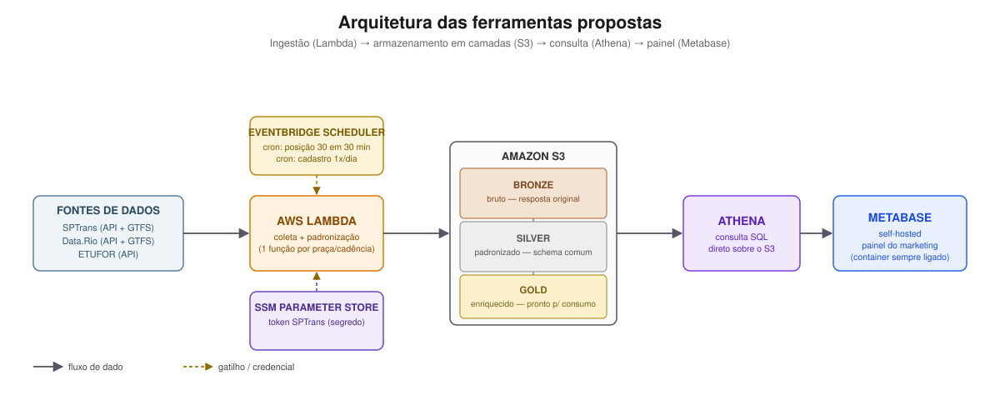

# Proposta Inicial — Mapeamento de Rotas de Ônibus

## Entendimento do problema

Precisamos dos dados de rotas de ônibus para apoiar o time de marketing nas decisões de quais campanhas implementar por região. Baseado em diversos fatores, como fluxo de pessoas e condições socioeconômicas, é possível definir quais os melhores anúncios para determinada região. A empresa atua nas cidades de Fortaleza, Rio de Janeiro e São Paulo.

Precisaremos criar um pipeline que faça a ingestão das APIs públicas de transporte de Fortaleza, Rio de Janeiro e São Paulo. Precisamos dos dados das linhas de ônibus, de todas as paradas por linha e da atualização em tempo real da posição do ônibus.

O pipeline precisará atualizar a cada 30 minutos. Será necessário um painel com visualizações a partir dos dados ingeridos.

## Dúvidas

- Para o caso dos pontos de uma linha, os dados disponibilizados precisam ser de geolocalização ou de endereço legível?
- A atualização deve ser 7 dias por semana, de 30 em 30 minutos?
- Fortaleza aceita granularidade de planejamento em vez de tempo real? Sem posição, a praça só pode ser servida por itinerário.
- Quantas pessoas vão acessar o painel de visualização? QuickSight cobra por assento ($24/autor + $3/leitor) e Metabase self-hosted tem custo fixo — o tamanho do time que vai olhar o painel decide qual é mais barato (ver Proposta de arquitetura). Enquanto isso, seguimos com Metabase self-hosted, por ser a opção mais robusta à incerteza (custo não sobe se o time crescer).

## Discovery de fontes

Foram testadas 3 fontes de APIs públicas: SPTrans, Data.Rio e ETUFOR.

- **SPTrans** e **Data.Rio** são APIs oficiais e possuem os dados de linhas, pontos e posição em tempo real do ônibus.
- **ETUFOR** é uma API não-oficial que tem os dados de linhas e pontos, mas não tem posição em tempo real do ônibus.

Todas as consultas são feitas via chamadas de API: a SPTrans precisa de um token público (gratuito, mediante cadastro); a Data.Rio não precisa de autenticação; e a ETUFOR tem somente dado estático, sem posição em tempo real do ônibus.

**Proposta:** disponibilizar os dados estáticos de linhas e de pontos por linha para as 3 praças. Disponibilizar a posição em tempo real apenas para São Paulo e Rio de Janeiro, únicas praças com essa fonte hoje.

### Visão geral das fontes

| Praça | Linhas | Veículos em circulação¹ | Pontos/trajeto | Posição em tempo real |
|---|---:|---:|---:|:---:|
| São Paulo (SPTrans) | 2.692 | 4.783 | 96.326 | ✅ |
| Rio de Janeiro (Data.Rio) | 498 | 1.921 | 52.505 | ✅ |
| Fortaleza (ETUFOR) | 539 | — | 19.417 | ❌ não existe |

¹ Contagem de veículos é um snapshot ao vivo — varia bastante conforme o horário do dia.

## Metadados por fonte ingerida

### 1. SPTrans — Olho Vivo API

| Campo | Valor |
|---|---|
| Praça | São Paulo |
| Tipo | API REST, tempo real |
| URL base | `http://api.olhovivo.sptrans.com.br/v2.1` |
| Autenticação | Sessão via cookie (`POST /Login/Autenticar?token=X`) |
| Formato | JSON |
| Status | Oficial, documentada, cadastro gratuito |
| Alimenta | `linhas.csv` (via varredura heurística 0-9/a-z), `posicoes.csv` (`GET /Posicao`) |
| Frequência de atualização na fonte | Tempo real (posição dos veículos) |
| Observações | Não tem endpoint de listagem completa de linhas; `/Parada/BuscarParadasPorLinha` cobre só ~18% das linhas (por isso não é mais usada para pontos) |

### 2. SPTrans — GTFS oficial

| Campo | Valor |
|---|---|
| Praça | São Paulo |
| Tipo | Arquivo estático (GTFS), download único |
| URL base | `https://www.sptrans.com.br/umbraco/Surface/PerfilDesenvolvedor/BaixarGTFS` |
| Autenticação | Nenhuma |
| Formato | Zip (~14 MB) com CSVs padrão GTFS |
| Status | Oficial, pública, sem necessidade de cadastro |
| Alimenta | `pontos.csv` (join `routes → trips → stop_times → stops`) |
| Frequência de atualização na fonte | Alta — observado `last-modified` com poucas horas de idade |
| Chave de junção | `route_short_name` no formato letreiro+sentido (ex: `"1012-10"`), não o `codigo_linha` numérico da Olho Vivo |
| Cache local | `.cache/gtfs_sptrans.zip` (sem expiração automática) |

### 3. Rio de Janeiro — Data.Rio GPS (SPPO)

| Campo | Valor |
|---|---|
| Praça | Rio de Janeiro |
| Tipo | API REST, tempo real |
| URL base | `https://dados.mobilidade.rio/gps/sppo` |
| Autenticação | Nenhuma |
| Formato | JSON — log bruto de pings de GPS (não é snapshot) |
| Status | Oficial (SMTR/Data.Rio), rotulada "beta" pela prefeitura |
| Alimenta | `posicoes.csv` (com deduplicação client-side por `id_veiculo`) |
| Frequência de atualização na fonte | ~1 ping a cada 30s por veículo |
| Particularidade | Parâmetros de data em formato `MM-dd-yyyy HH:mm:ss` (não documentado; formato brasileiro falha silenciosamente com `[]` e HTTP 200) |

### 4. Rio de Janeiro — GTFS oficial

| Campo | Valor |
|---|---|
| Praça | Rio de Janeiro |
| Tipo | Arquivo estático (GTFS), download único |
| URL base | `https://www.arcgis.com/sharing/rest/content/items/8ffe62ad3b2f42e49814bf941654ea6c/data` (ArcGIS Hub / Data.Rio) |
| Autenticação | Nenhuma |
| Formato | Zip (~25 MB) com CSVs padrão GTFS |
| Status | Oficial (SMTR) |
| Alimenta | `linhas.csv` e `pontos.csv` (mesmo join `routes → trips → stop_times → stops`) |
| Frequência de atualização na fonte | Mensal |
| Cache local | `.cache/gtfs_rio.zip` (sem expiração automática) |

### 5. Fortaleza — API ETUFOR

| Campo | Valor |
|---|---|
| Praça | Fortaleza |
| Tipo | API REST, não-oficial |
| URL base | `http://gistapis.etufor.ce.gov.br:8081/api` |
| Autenticação | Nenhuma |
| Formato | JSON |
| Status | Não-oficial — descoberta via gist da comunidade, sem documentação, sem SLA, porta não padrão |
| Alimenta | `linhas.csv` (`/linhas/`), `pontos.csv` (`/itinerario/{id}`, sequência de logradouros sem lat/long) |
| Frequência de atualização na fonte | Desconhecida (cadastro, não tempo real) |
| Observações | Sem fonte de posição em tempo real (nenhuma encontrada, oficial ou não); pelo menos 1 código de linha retorna erro 500 de forma intermitente |

## Proposta de arquitetura

**Postura:** arquitetura agnóstica de nuvem sempre que possível. Onde isso esbarrar em alguma limitação prática, implementamos direto na AWS.

O padrão de uso é em rajadas curtas — cada ingestão dura de segundos a poucos minutos, seguida de ociosidade — não um processo contínuo rodando o tempo todo. Isso pesa a favor de uma arquitetura **serverless**: paga-se pelo que roda, não por um servidor sempre ligado esperando o próximo agendamento.

### Desenho da arquitetura

*Linhas pontilhadas = gatilho/credencial (agendamento ou segredo); linhas cheias = fluxo de dado. Arquivo em `arquitetura-proposta.svg`, na raiz do repositório — é uma imagem estática, então renderiza em qualquer visualizador de Markdown, sem depender de suporte a Mermaid.*

### Camadas de dados — arquitetura medallion

O armazenamento segue o padrão **medallion** (bronze/silver/gold), que já aparece no diagrama acima como bruto → padronizado → enriquecido:

| Camada | Nome usual | Conteúdo | Formato |
|---|---|---|---|
| Bronze | bruto | Resposta original da API/GTFS, sem transformação, imutável | JSON / GTFS como veio da fonte |
| Silver | padronizado | Dado limpo e deduplicado, com schema comum entre as 3 praças (mesmo nome de campo para linha, ponto, posição) | Parquet |
| Gold | enriquecido | Dado pronto para consumo — posição já associada à região, agregações que o painel consulta direto | Parquet |

Cada camada existe por um motivo diferente: a bronze permite reprocessar sem re-consultar a fonte (as APIs não guardam histórico — o que não for capturado na hora, se perde); a silver é onde SP, Rio e Fortaleza passam a "falar a mesma língua"; a gold é o que o painel de fato lê.

| Componente | Escolha | Por quê |
|---|---|---|
| Cadência de coleta | Posição a cada 30 min; linhas/pontos 1x/dia | Posição é o dado volátil; linhas e pontos mudam raramente — coletar os dois na mesma cadência gastaria chamadas sem ganho de frescor |
| Compute | AWS Lambda, uma função por praça e tipo de coleta | Execuções curtas e espaçadas ao longo do dia; um servidor sempre ligado ficaria ocioso na maior parte do tempo |
| Orquestração | EventBridge Scheduler (cron nativo) | Agenda declarativa, sem lógica de calendário dentro do código |
| Armazenamento | S3, em camadas medallion (ver acima) | Separa dado bruto imutável de dado tratado, sem misturar responsabilidades numa única tabela |
| Formato | Parquet particionado | Formato aberto e compacto, lido por qualquer motor de consulta |
| Consulta | Athena, direto sobre o S3 | Sem servidor de banco para manter; cobra por dado escaneado, e o volume aqui é pequeno |
| Painel | Metabase self-hosted, num container pequeno sempre ligado | Custo fixo, independente de quantos leitores acessam — suporta Athena nativamente desde a v0.45, sem plugin de terceiros |
| Segredos | Parâmetro seguro (ex: SSM Parameter Store) | Só o token da SPTrans precisa de proteção; não há necessidade de rotação automática |
| Tolerância a falha | Pular item com erro e seguir a coleta | Uma linha ou parada com erro pontual (já visto na ETUFOR) não pode travar a coleta das demais |

**Por que Metabase self-hosted, por enquanto:** ainda não sabemos quantas pessoas vão acessar o painel (ver Dúvidas). QuickSight cobra por assento ($24/autor + $3/leitor); Metabase self-hosted é custo fixo (~$18/mês numa instância pequena), então é a escolha mais robusta à incerteza — não piora se o time de marketing for maior do que o esperado. O trade-off é reintroduzir o único componente sempre ligado de toda a arquitetura, com o ônus de manter esse servidor no ar recaindo sobre quem opera o pipeline. Se a resposta à dúvida mostrar um time pequeno (2-3 leitores), vale reavaliar QuickSight — os custos ficam próximos nesse volume, e o QuickSight não exige manter servidor nenhum.

**O que fica agnóstico de nuvem:** o código de coleta e transformação, o formato dos dados (Parquet), a API de armazenamento (S3, compatível com outros provedores) e o próprio painel — Metabase roda em container em qualquer nuvem ou on-premise. **O que é específico da AWS:** o mecanismo de agendamento e o runtime de execução da coleta — uma eventual troca de nuvem afeta só essa camada fina.

## Estimativa de custo mensal

Cálculo baseado na cadência já definida (posição a cada 30 min, cadastro 1x/dia) rodando 24h nos 7 dias da semana — é a leitura mais conservadora enquanto a dúvida sobre uma janela reduzida não é respondida. Se a resposta vier nesse sentido, o custo cai na mesma proporção, sem mudar a arquitetura.

- Posição: 48 execuções/dia por praça (SP, Rio) × ~30 dias ≈ 1.440/mês por praça
- Cadastro: 1 execução/dia por praça (SP, Rio, Fortaleza) × ~30 dias ≈ 30/mês por praça
- **Total: ~2.970 ingestões/mês**

| Item | Cálculo | Custo mensal |
|---|---|---:|
| Lambda (compute) | ~5.610 GB-s e ~2.970 execuções — ambos dentro do free tier perpétuo (400.000 GB-s / 1.000.000 execuções) | $0,00 |
| EventBridge Scheduler | 2.970 disparos — free tier cobre 14 milhões/mês | $0,00 |
| S3 — armazenamento (dado novo por mês) | ~14 GB/mês, a maior parte é o log bruto de GPS do Rio antes da deduplicação | ~$0,30 |
| S3 — requisições | ~8.900 PUTs/mês | ~$0,05 |
| Athena | Poucos GB escaneados por mês, a $5/TB | < $0,05 |
| CloudWatch Logs | Volume baixo, piso de segurança | ~$0,50–1,00 |
| SSM Parameter Store | 1 segredo, tier gratuito | $0,00 |
| Metabase (container pequeno, sempre ligado) | 0,5 vCPU / 1 GB, 24/7 (~730h/mês) | ~$15–18 |
| **Total mês 1** | | **≈ $16–19/mês** |

Esse custo **não muda com o número de leitores** — é a vantagem direta de ser um custo fixo de servidor, não por assento. Ele cresce um pouco se o banco de metadados do Metabase (hoje embutido, tipo SQLite) for trocado por um Postgres gerenciado antes de virar produção — soma mais ~$12–15/mês, ficando em torno de **$28–33/mês**, ainda recomendado para não perder dashboards/usuários se o container reiniciar. A camada bronze é imutável — nada é apagado por padrão — então o custo de armazenamento também cresce mês a mês; sem política de expurgo, a projeção para o fim do ano 1 fica em torno de **$20–25/mês** (com banco embutido) ou **$32–37/mês** (com Postgres gerenciado), dominada pelo servidor do painel, não pelo armazenamento acumulado (esse continua marginal, na casa de poucos dólares).

Se a dúvida sobre o número de leitores for respondida com um time pequeno (2-3 pessoas), o QuickSight volta a ser competitivo: ~$33/mês fixo, sem servidor pra manter — vale comparar os dois de novo nesse cenário antes de decidir de vez.

## Mapa de riscos

Riscos identificados durante o discovery e a proposta de arquitetura, com o que já mitiga cada um ou o que falta decidir para isso.

| Risco | Impacto | Mitigação |
|---|---|---|
| Fortaleza não tem fonte pública de posição em tempo real | Praça fica sem paridade com SP e Rio para decisões por posição instantânea | Servir Fortaleza por itinerário (cobertura estática por linha), não por posição — já assumido na proposta |
| API da ETUFOR é não-oficial, sem SLA, porta não padrão | Pode mudar de formato ou sair do ar sem aviso — já confirmado erro 500 intermitente em pelo menos 1 código de linha | Isolar a coleta de Fortaleza numa função própria; tolerar falha por item (já no desenho); portal oficial de dados estáticos como plano B |
| SPTrans não tem endpoint de listagem completa de linhas | A varredura heurística (dígitos 0-9 e letras a-z) pode não cobrir 100% das linhas em algum momento futuro | Validar periodicamente a contagem contra o GTFS oficial da SPTrans, já usado para os pontos |
| API de GPS do Data.Rio é rotulada "beta" pela prefeitura | O contrato pode mudar sem aviso formal, quebrando a coleta de posição do Rio | Monitorar falhas de execução da Lambda; tratar como dependência instável na documentação operacional |
| Formato de data do Rio (`MM-dd-yyyy`) não é documentado oficialmente | Formato errado retorna `[]` com HTTP 200 — falha silenciosa, sem erro visível | Validar o formato na implementação; nunca confiar só no status HTTP para saber se a coleta funcionou |
| Cache local do GTFS (SP e Rio) não expira sozinho | Pipeline pode operar com malha de linhas/pontos desatualizada por tempo indefinido | Definir política de expiração do cache (ex: por idade do arquivo) antes de produção |
| Camada bronze é imutável e cresce todo mês | Custo de armazenamento sobe com o tempo, sem teto natural (ver Estimativa de custo) | Definir política de ciclo de vida no S3 (ex: mover para camada fria após alguns meses) |
| Metabase self-hosted é o único componente sempre ligado da arquitetura | Se o container cair, o painel fica indisponível; alguém precisa operar e atualizar esse servidor | Trade-off consciente (ver Proposta de arquitetura); reavaliar QuickSight se o time de leitores for pequeno |
| Escolha do painel (Metabase vs QuickSight) depende de dúvida em aberto | Pode exigir retrabalho de infraestrutura se a resposta mudar a escolha | Metabase escolhido por ser robusto à incerteza (custo fixo); decisão marcada como provisória no documento |
| Janela/cadência de atualização depende de outra dúvida em aberto | Estimativa de custo atual usa o cenário mais caro (24/7, 7 dias) como piso conservador | Custo cai na mesma proporção assim que a resposta vier — não exige mudar a arquitetura |

